# Rethinking Credit Assignment in Cooperative MARL via Interventional Reward Response

This repository provides the official implementation of:

<p align="center">
  <b>Rethinking Credit Assignment in Cooperative MARL via Interventional Reward Response</b><br>
  Chamjin Joo · Myoung Hoon Ha · Sang Wan Lee
</p>

<p align="center">
  <a href="https://openreview.net/forum?id=FOmIe6PtvT">Paper</a>
</p>

<p align="center">
  <a href="#overview">Overview</a> ·
  <a href="#installation">Installation</a> ·
  <a href="#usage">Usage</a> ·
  <a href="#results">Results</a> ·
  <a href="#code-layout">Code Layout</a> ·
  <a href="#citation">Citation</a>
</p>

---

## TL;DR

We formulate agent-wise credit in cooperative MARL as an **Interventional Reward Response (IRR)**: how the global reward responds to intervening on the agent’s action—rather than relying solely on observational reward associations. Because the state involved in reward is unobserved in a Dec-POMDP, we use **Proximal Causal Inference (PCI)** to identify the IRR from observable proxy variables through an outcome bridge function. The identified causal structure is then used to construct a credit-aligned correction signal for individual policy updates.

---

## Overview

### Proposed Framework

<p align="center">
  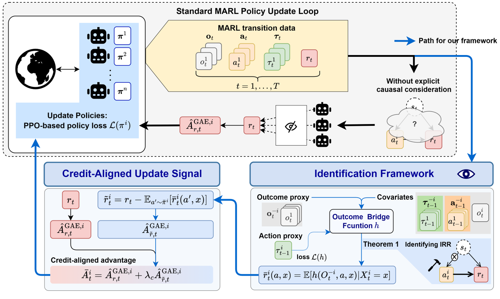
</p>

#### **Identification framework.**  
We use PCI to identify the IRR from observational trajectories without directly observing the environment state. We also propose a outcome bridge training method using MARL transition data.

<p align="center">
  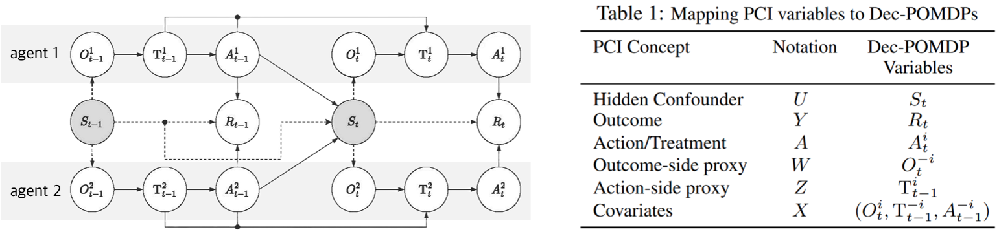
</p>

For an agent $i$, we instantiate the PCI variables as

- hidden confounder: $U = S_t$,
- outcome: $Y = R_t$,
- action/treatment: $A = A_t^i$,
- outcome-side proxy: $W = O_t^{-i}$,
- action-side proxy: $Z = T_{t-1}^i$,
- covariateds: $X = (O_t^i, T_{t-1}^{-i}, A_{t-1}^{-i})$.

Under the assumptions described in the paper, the outcome bridge identifies the IRR.

#### **Credit-aligned update signal.**  
A learned outcome bridge provides counterfactual reward information, which is used to construct an auxiliary credit-aligned reward for individual updates.


## Installation

The experiments were run with:

- Python 3.10.18
- PyTorch 2.7.1
- JAX 0.4.38
- PyTorch CUDA 12.6
- JAX CUDA 12 stack (CUDA 12.9 compiler helpers)

We recommend installing the dependencies using:

```bash
bash install.sh
```

`install.sh` installs PyTorch with CUDA 12.6 and the JAX CUDA 12 stack, including CUDA 12.9 compiler helpers for JAX.


## Usage

### Option 1: `main.py`

The main training entry point supports the following options:

```text
main.py
  --env ${env}
      Training environment.

  --config ${config}
      Training configuration.
      Choose the appropriate environment/model configuration in ./configs/.

  --model ${model}
      Training model:
      Torch: {r-pci, r-ippo, r-mappo, qmix}
      JAX: {jax-ippo, jax-mappo, jax-pci-ippo, jax-pci-mappo, jax-qmix}

      JAX environments (SMAX and JaxLBF) require a jax-* model.

  --use-centralized-critic ${use_centralized_critic}
      For r_pci, choose whether to use an IPPO- or MAPPO-based backbone.

  --causal-lambda ${causal_lambda}
      Coefficient for the PCI-based credit correction.

  --device ${device}
      CPU/GPU device.

  --seed ${seed}
      Training seed.

  --use-wandb
      Enable Weights & Biases logging.
```

Minimal direct invocation:

```bash
python main.py --config configs/staghunt_configs/staghunt_ippo.yaml \
  --env StagHunt --model r-ippo --device cpu
```

### Option 2: Training Scripts

Benchmark-specific training scripts are provided under `scripts/`.

- `scripts/staghunt/`: Stag-Hunt experiments
- `scripts/smax/`: SMAX experiments
- `scripts/lbf/`: LBF experiments

Each script exposes the main experimental settings near the top of the file, including the configuration, model, seed(s), device, and environment-specific options.

Example commands:

```bash
bash scripts/staghunt/train_ippo.sh
bash scripts/smax/train_ippo.sh
```

Some scripts enable Weights & Biases logging by default. If external logging is not needed, remove or comment out the corresponding `--use-wandb` argument before running the script. 


## Results
### Oracle Validation of the Identification Framework

<p align="center">
  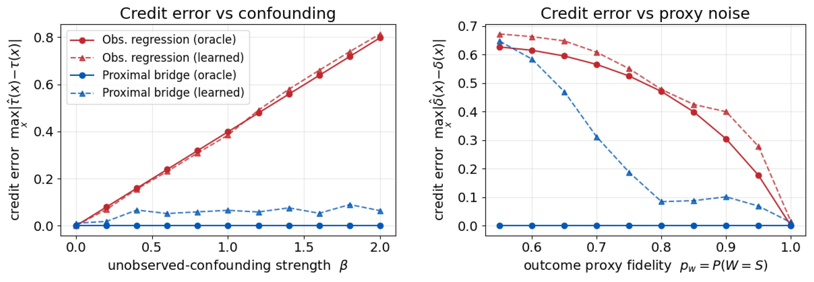
</p>

The controlled oracle experiment evaluates whether the proximal bridge recovers the intended interventional credit signal under hidden confounding.

The proximal bridge remains robust as the confounding strength increases, whereas the observational regression error grows with confounding. As the outcome-side proxy becomes less informative, the advantage of the bridge decreases, consistent with the identification conditions discussed in the paper.

### MARL Benchmark Evaluation

We evaluate PCI-IPPO and PCI-MAPPO on three cooperative MARL benchmarks:

- Stag-Hunt
- SMAX
- Level-Based Foraging (LBF)

#### Stag-Hunt and Level-Based Foraging
**Result Table**
<p align="center">
  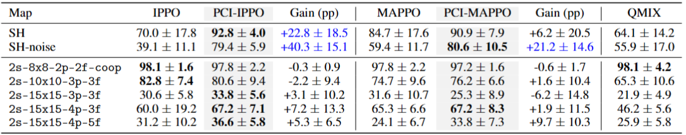
</p>

The largest improvements appear on the diagnostic Stag-Hunt environments, including the noisy-observation setting. On LBF, the PCI variants remain broadly comparable to their corresponding backbones, with small and mixed gains across tasks.

#### SMAX

**Replays** (model: PCI-MAPPO)
<table>
  <tr>
    <td width="33%" align="center">
      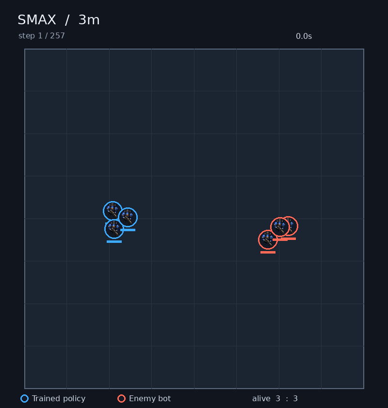
      <br>
      <sub><b>3m: Hard</b></sub>
    </td>
    <td width="33%" align="center">
      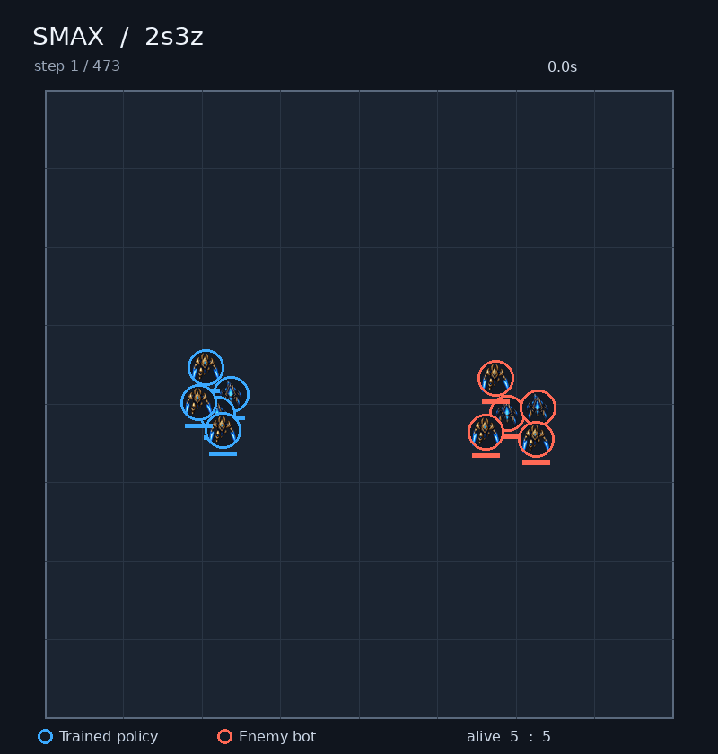
      <br>
      <sub><b>2s3z: Hard</b></sub>
    </td>
    <td width="33%" align="center">
      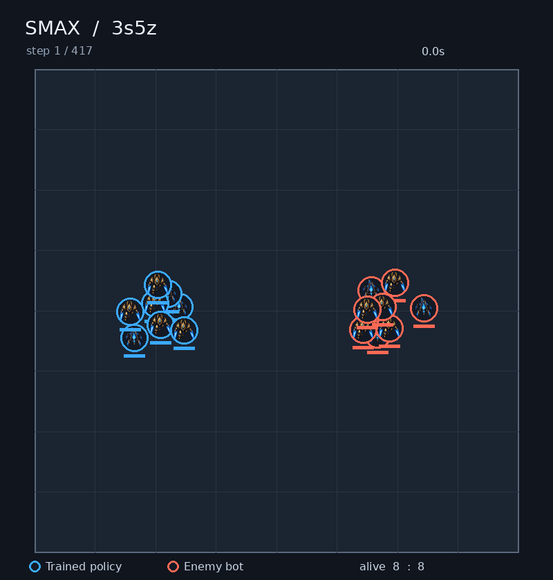
      <br>
      <sub><b>3s5z: Hard</b></sub>
    </td>
  </tr>
  <tr>
    <td width="33%" align="center">
      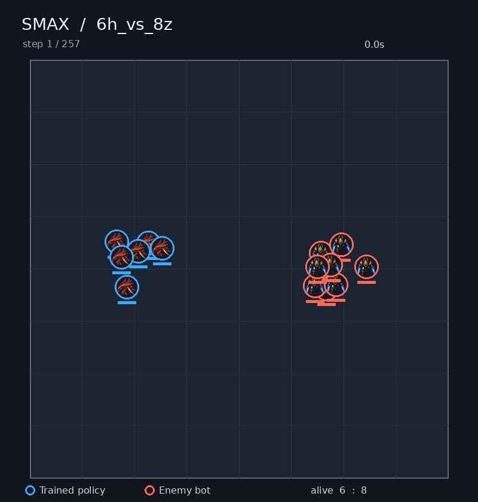
      <br>
      <sub><b>6h_vs_8z: Hard</b></sub>
    </td>
    <td width="33%" align="center">
      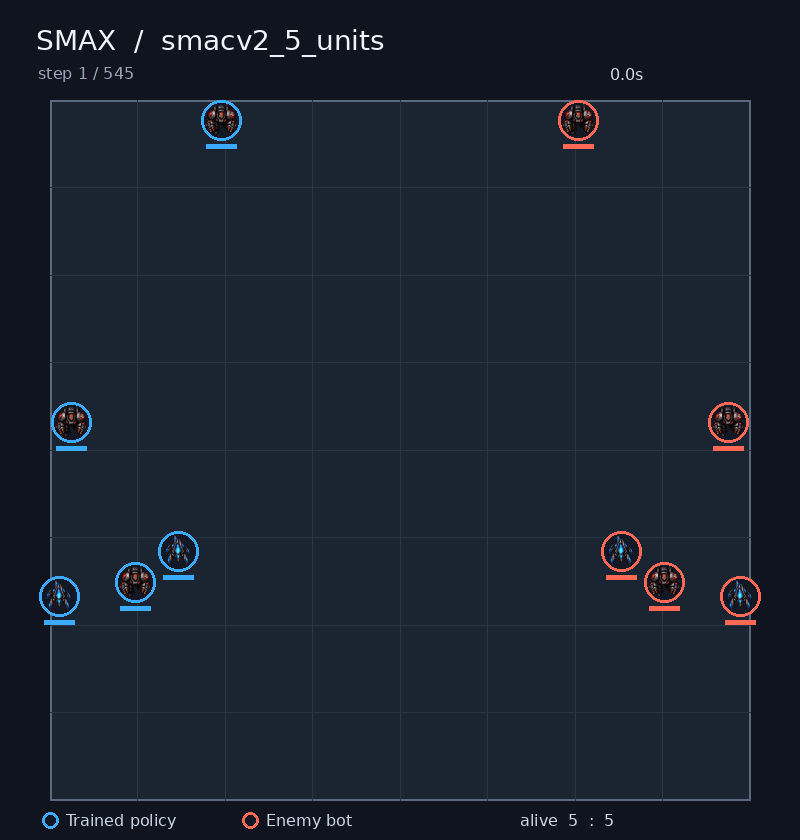
      <br>
      <sub><b>smacv2_5_units: Hard</b></sub>
    </td>
    <td width="33%" align="center">
      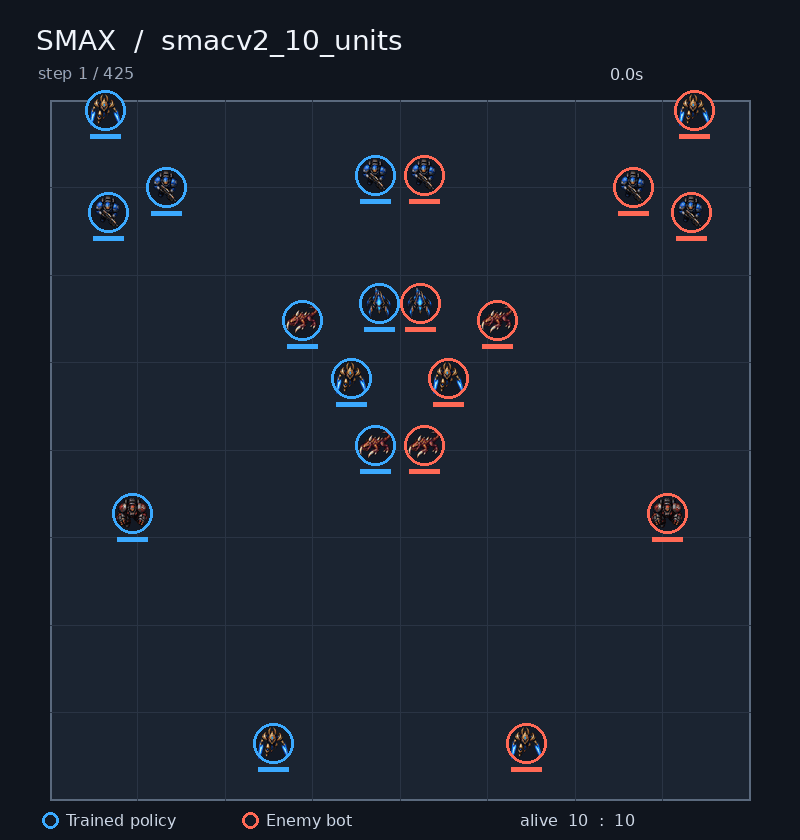
      <br>
      <sub><b>smacv2_10_units: Hard</b></sub>
    </td>
  </tr>
</table>

**Result Table**
<p align="center">
  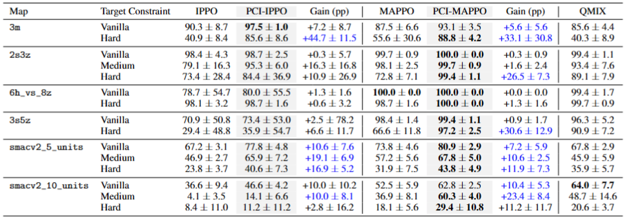
</p>

Across the SMAX scenarios, PCI variants improve over their corresponding IPPO/MAPPO backbones in most settings, with particularly large gains in several target-constrained tasks.

Across all 22 benchmark tasks, the aggregate interquartile mean (IQM) improves

- from **58.6 to 75.9** for PCI-IPPO, and
- from **70.7 to 83.8** for PCI-MAPPO.

See the paper for the full statistical analysis, performance profiles, confidence intervals, and ablation studies.


## Code Layout

```text
.
├── configs/          Experiment configurations
├── envs/             Multi-agent environments and wrappers
├── models/
│   ├── torch/        PyTorch implementations
│   └── jax/          JAX implementations
├── runner/
│   ├── torch/        PyTorch training loops
│   └── jax/          JAX training loops
├── scripts/          Benchmark-specific training scripts
├── utils/            Shared utility functions
├── main.py           Main training entry point
└── install.sh        Recommended dependency installation script
```

The PyTorch and JAX backends are used for different benchmark implementations; see the corresponding scripts and configuration files for experiment-specific settings.


## Citation

If you find this work useful, please cite:

```bibtex
@inproceedings{joo2026rethinking,
  title     = {Rethinking Credit Assignment in Cooperative {MARL} via Interventional Reward Response},
  author    = {Joo, Chamjin and Ha, Myoung Hoon and Lee, Sang Wan},
  booktitle = {Advances in Neural Information Processing Systems},
  year      = {2026},
  url       = {https://openreview.net/forum?id=FOmIe6PtvT}
}
```
