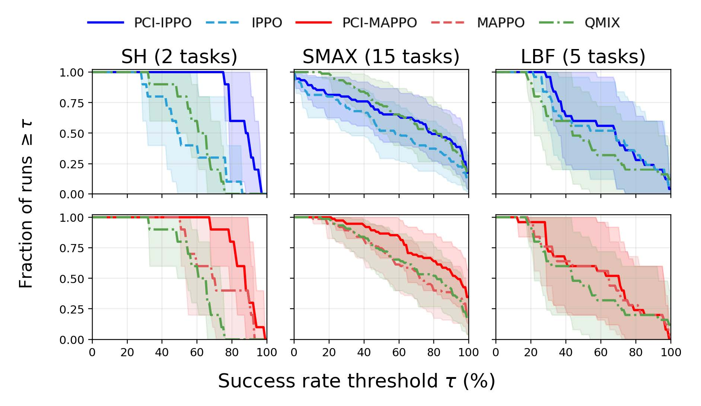

# Rethinking Credit Assignment in Cooperative MARL via Interventional Reward Response
This is an implemation of the following paper.
<p align="center">
  <b>Rethinking Credit Assignment in Cooperative MARL via Interventional Reward Response</b><br>
  Chamjin Joo · Myoung Hoon Ha · Sang Wan Lee
</p>

<p align="center">
  <a href="https://openreview.net/forum?id=FOmIe6PtvT">Paper</a> ·
  <a href="#quick-start">Quick Start</a> ·
  <a href="#training">Training</a> ·
  <a href="#results">Results</a>
</p>

**TL;DR:** We introduce PCI-IPPO/MAPPO, a causal credit assignment framework that uses interventional reward responses to guide policy updates in cooperative MARL.

<p align="center"></p>

## Our approach
To address the credit assignment in cooperative MARL problems, we define a causal contribution of each agent as **interventaional reward response (IRR)** based on the theoretical framework of causal inference. Finally, we design a policy-based MARL framework using IRRs for credit-aligned policy udpate signals.

<p align="center"></p>
<p align="center"></p>
<p align="center"></p>

## What does this code do?

## Get started

Create a conda environment and install dependencies:

```bash
conda create -n env_name python=3.10.18 -y
conda activate env_name
bash install.sh
```

Dependency: 
- Python ver, Pytorch, Jax 등 필수 library version/version범위 명시.
- `requirements.txt` does not contain all necessary libraries. Please see the `install.sh` for more information. 

## Training scripts

- `scripts/staghunt/`: Torch Stag Hunt experiments.
- `scripts/smax/`: JAX SMAX experiments.

Each script exposes its main settings near the top of the file, such as
`config`, `model`, `seed` or `seeds`, `device`, and environment-specific
options.

Example commands:

```bash
bash scripts/staghunt/train_ippo.sh
bash scripts/smax/train_ippo.sh
```

Some scripts enable Weights & Biases logging by default. If external logging is
not needed, remove or comment out the corresponding `--use-wandb` arguments in
the script before running it.

## Code layout

- `models/torch/`: Torch algorithm implementations used for Stag Hunt.
- `models/jax/`: JAX algorithm implementations used for SMAX.
- `configs/`: YAML and dataclass-based experiment configuration.
- `envs/`: multi-agent environments and wrappers.
- `runner/torch/`, `runner/jax/`: training loops for Torch and JAX.
- `utils/`: shared utility code.

## Citation
```
@inproceedings{anonymous2026rethinking,
    title={Rethinking Credit Assignment in Cooperative {MARL} via Interventional Reward Response},
    author={Anonymous},
    booktitle={The Fortieth Annual Conference on Neural Information Processing Systems},
    year={2026},
    url={https://openreview.net/forum?id=FOmIe6PtvT}
}
```